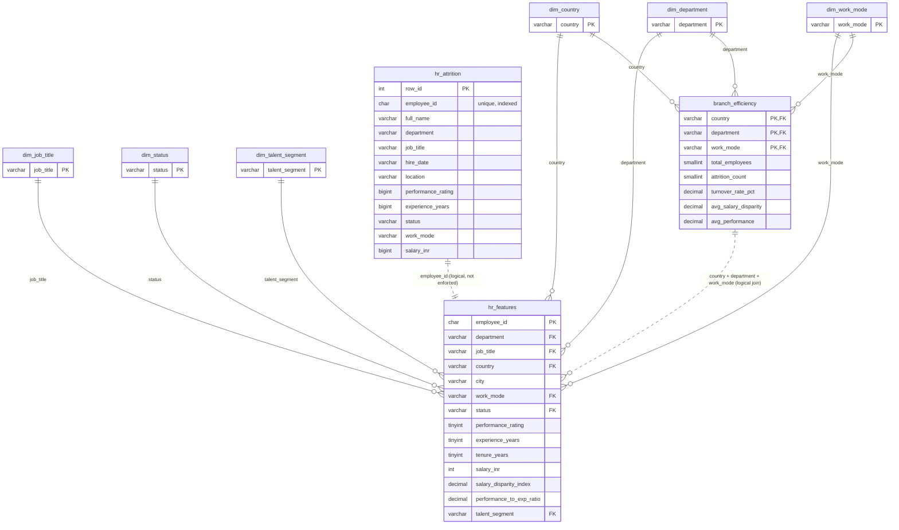

# HR Talent & Attrition Analytics — SQL Database Layer

This folder contains the relational part of the project. It loads the existing
2,000,000-row `hr_attrition` table and the two processed datasets into MySQL,
adds keys/indexes, and exports the aggregate results needed by the later NoSQL
stage.

The NoSQL database is **not** touched here.

---

## 1. Data sources

| File | Rows | Loaded into |
|---|---:|---|
| MySQL table `hr_attrition` (already in `db_hr_mnc`) | 2,000,000 | `hr_attrition` |
| `data-science/output/hr_features.parquet` | 2,000,000 | `hr_features` |
| `data-science/output/new_dataset_branch_efficiency.csv` | 3,402 | `branch_efficiency` |

The parquet has 14 columns. `Talent_Segment` is kept as a normal display/analysis
column, not as a model feature.

---

## 2. Prerequisites

- Python 3.10+
- Local MySQL 8.x (Laragon in this project) running on port 3306
- Database `db_hr_mnc`

Install the Python dependencies:

```bash
python -m pip install pandas pyarrow SQLAlchemy PyMySQL python-dotenv
```

Create your credentials file:

```bash
cd database/sql
copy .env.example .env        # Windows
# cp .env.example .env        # Linux/macOS
```

Fill in `DB_PASSWORD` in `.env`. The local Laragon `root` account can use an
empty password. `.env` is git-ignored; never commit real credentials.

Optional path overrides in `.env`:

```dotenv
HR_FEATURES_PARQUET=data-science/output/hr_features.parquet
BRANCH_EFFICIENCY_CSV=data-science/output/new_dataset_branch_efficiency.csv
```

---

## 3. Run order

Run these from `database/sql/`:

```bash
# 1. Verify the existing 2M-row table (read-only)
python inspect_db.py

# 2. Create new tables + dimensions.  The PK migration is guarded:
#    it prints the exact ALTER and only runs with --apply-pk.
python create_schema.py --phase base --apply-pk --yes

# 3. Load the processed datasets in 50,000-row chunks
python load_data.py

# 4. Add secondary indexes + foreign keys and save EXPLAIN plans
python create_schema.py --phase indexes

# 5. Run Task 5 queries and write JSON outputs
python queries.py
```

If you do **not** want to apply the `hr_attrition` PK migration, run step 2
without `--apply-pk`; the script prints the SQL and continues. Task 4 still
requires a primary key on every table, so the migration is recommended.

All scripts are idempotent: `CREATE TABLE IF NOT EXISTS`, `INSERT IGNORE`,
`information_schema` checks before adding indexes/FKs, and row-count checks
before loading.

### 3.1 Add or repair the foreign keys

`fix_relations.py` inspects the five target relationships, checks row counts,
column compatibility, orphan rows, and dimension whitespace/casing, then adds
only the constraints that pass. It never drops a table and never changes
`hr_attrition` columns.

```bash
# Inspect only (Steps 1-2). Prints every planned ALTER; changes nothing.
python fix_relations.py --dry-run

# Interactive: prints each statement and waits for YES before executing.
python fix_relations.py

# Non-interactive, only after the operator has approved the dry-run output.
python fix_relations.py --yes
```

It also writes `relations_report.md` with the before/after FK list, row counts,
orphan checks, dimension quality checks, and the JOIN proof.

Final relationship list (10 FKs):

| child.column | parent.column | constraint |
|---|---|---|
| `branch_efficiency.country` | `dim_country.country` | `fk_branch_country` |
| `branch_efficiency.department` | `dim_department.department` | `fk_branch_department` |
| `branch_efficiency.work_mode` | `dim_work_mode.work_mode` | `fk_branch_work_mode` |
| `hr_features.country` | `dim_country.country` | `fk_hf_country` |
| `hr_features.department` | `dim_department.department` | `fk_hf_department` |
| `hr_features.work_mode` | `dim_work_mode.work_mode` | `fk_hf_work_mode` |
| `hr_features.job_title` | `dim_job_title.job_title` | `fk_hf_job_title` |
| `hr_features.status` | `dim_status.status` | `fk_hf_status` |
| `hr_features.talent_segment` | `dim_talent_segment.talent_segment` | `fk_hf_talent_segment` |
| `hr_features.employee_id` | `hr_attrition.employee_id` | `fk_hf_attrition` |

All new constraints use `ON UPDATE CASCADE` and `ON DELETE RESTRICT`.
The nine constraints created earlier by `create_schema.py --phase indexes` keep
their default `ON UPDATE NO ACTION ON DELETE NO ACTION` (MySQL treats `NO ACTION`
as `RESTRICT`). `fk_hf_attrition` uses `CHAR(10)` → `VARCHAR(255)`; both sides
share `utf8mb4_0900_ai_ci`, so MySQL accepted the FK, but the parent unique index
is wider than necessary (`key_len=1023`), which makes the 2M-row JOIN slower than
it could be. Widening `hr_features.employee_id` is **not** required and was not
done, because `hr_attrition` columns must stay unchanged.

---

## 4. Final schema

| Table | Rows | Primary key | Foreign keys | Secondary indexes |
|---|---:|---|---|---|
| `hr_attrition` | 2,000,000 | `row_id` | — | `uq_hr_attrition_employee_id` (unique), `idx_hr_attrition_department`, `idx_hr_attrition_status`, `idx_hr_attrition_work_mode`, `idx_hr_attrition_hire_date` |
| `hr_features` | 2,000,000 | `employee_id` | `country` → `dim_country`, `department` → `dim_department`, `work_mode` → `dim_work_mode`, `job_title` → `dim_job_title`, `status` → `dim_status`, `talent_segment` → `dim_talent_segment`, `employee_id` → `hr_attrition.employee_id` | `idx_hf_talent_segment`, `idx_hf_country`, `idx_hf_city`, `idx_hf_department`, `idx_hf_work_mode`, `idx_hf_status`, `idx_hf_job_title`, `idx_hf_sdi`, `idx_hf_branch_join` (`country, department, work_mode`) |
| `branch_efficiency` | 3,402 | `(country, department, work_mode)` | `country` → `dim_country`, `department` → `dim_department`, `work_mode` → `dim_work_mode` | `idx_branch_department`, `idx_branch_work_mode`, `idx_branch_turnover` |
| `dim_country` | 243 | `country` | — | — |
| `dim_department` | 7 | `department` | — | — |
| `dim_job_title` | 29 | `job_title` | — | — |
| `dim_work_mode` | 2 | `work_mode` | — | — |
| `dim_status` | 4 | `status` | — | — |
| `dim_talent_segment` | 4 | `talent_segment` | — | — |

### Why the raw table still has `varchar(255)`

`hr_attrition` was created by the earlier CSV-to-MySQL import. It is kept as
the raw landing table so the source data is not rewritten. Only the leftover
CSV index column was renamed and promoted to a primary key. The new processed
tables use tight types derived from the real data.

### Tight types in the processed tables

- `hr_features`: `CHAR(10)`, `VARCHAR(10/29/51/24/7/10/33)`, `TINYINT UNSIGNED`,
  `INT UNSIGNED`, `DECIMAL(12,10)` for SDI and PER.
- `branch_efficiency`: `VARCHAR(51/10/7)`, `SMALLINT UNSIGNED`,
  `DECIMAL(5,3)`, `DECIMAL(6,4)`, `DECIMAL(4,3)`.

### Why there is no `dim_city`

`City` has 104,479 distinct names, but names are reused across countries:
`(City, Country)` has 1,593,497 distinct pairs. A properly keyed city dimension
would therefore have almost as many rows as the fact table, while a
city-name-only dimension would lose the country context. City is kept as a
normal indexed column in `hr_features`; the other low-cardinality categories
are normalized.

---

## 5. ER diagram



> Solid lines `--` are enforced foreign keys. Dashed lines `..` are logical
> relationships used for joins but not enforced as FK constraints.

### Text description

- One **country** has many **departments** conceptually, but in this dataset the
  branch grain is `(country, department, work_mode)`.
- `dim_country`, `dim_department`, `dim_work_mode`, `dim_job_title`,
  `dim_status`, and `dim_talent_segment` are small reference tables keyed by
  their natural business key.
- `hr_features` is the employee-level fact table. Each row is one employee and
  references the six dimensions above through foreign keys. Its primary key is
  `employee_id`.
- `branch_efficiency` is the branch-level fact/aggregate table. Its primary key
  is `(country, department, work_mode)`, and each of those columns is also a
  foreign key to its dimension.
- Every `hr_features` row joins to exactly one `branch_efficiency` row on
  `(country, department, work_mode)`. This is the relation used to prove the
  JOIN in Task 5.
- `hr_attrition` is the raw landing table. `hr_features.employee_id` values all
  exist in `hr_attrition.employee_id`, which is unique and indexed.

```
dim_country ──┐
dim_department ──┼──< hr_features >── (employee-level fact)
dim_work_mode ──┤
dim_job_title ──┤
dim_status ──┤
dim_talent_segment ──┘

dim_country ──┐
dim_department ──┼──< branch_efficiency >── (branch-level fact)
dim_work_mode ──┘

hr_attrition (raw 2M)  ── employee_id ──  hr_features
```

---

## 6. Task 5 outputs

`queries.py` writes these files to `database/sql/output/`:

| File | Content |
|---|---|
| `q1_underpaid.json` | Total employees + count/% with `Salary_Disparity_Index < 0.9` |
| `q2_talent_segments.json` | Count and percentage per `Talent_Segment` |
| `q3_branch_efficiency.json` | All 3,402 branch-efficiency rows |
| `q4_join_branch.json` | JOIN proof: joined row count, unmatched checks, and per-branch actual vs expected employees |

`create_schema.py --phase indexes` also writes:

- `output/explain_before.json` — plans captured before secondary indexes exist
- `output/explain_after.json` — plans captured after indexes/FKs exist

---

## 7. Expected verification results

```
hr_attrition       2,000,000
hr_features        2,000,000
branch_efficiency      3,402
feature rows without raw employee   0
feature rows without branch         0
branch rows without features        0
distinct branch combinations    3,402
SUM(branch total_employees)  2,000,000
```

---

## 8. Troubleshooting

- **`Can't connect to MySQL`** — start MySQL (Laragon) and check `DB_HOST`,
  `DB_PORT`, `DB_USER`, `DB_PASSWORD` in `.env`.
- **`Table hr_features is missing`** — run `create_schema.py --phase base`
  before `load_data.py`.
- **Load was interrupted** — simply re-run `load_data.py`; `INSERT IGNORE` and
  the primary keys make it safe.
- **Index already exists** — the scripts check `information_schema` first, so
  this is expected and harmless on re-runs.
